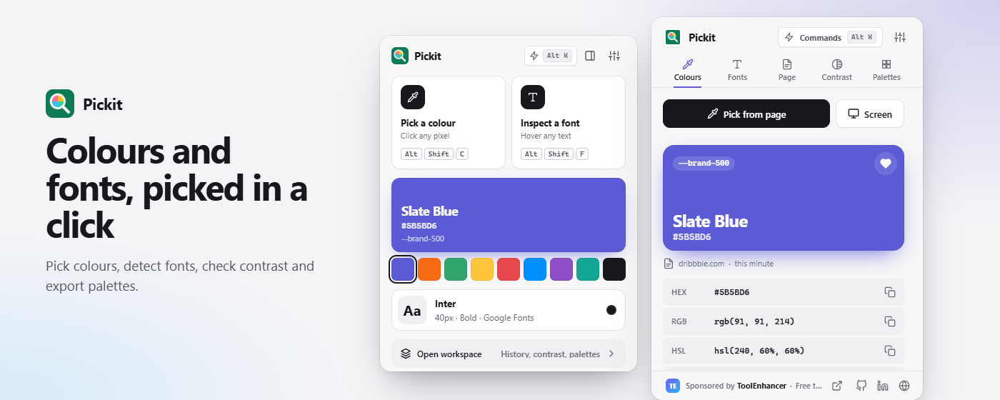
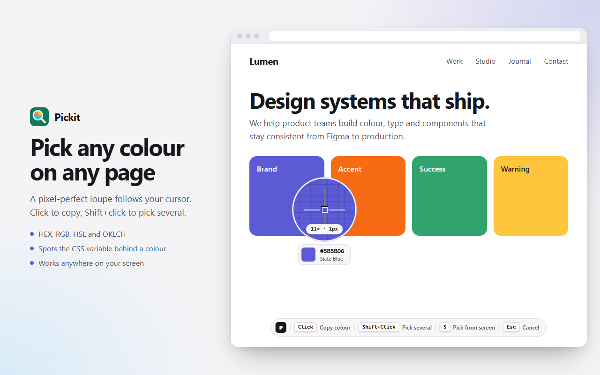
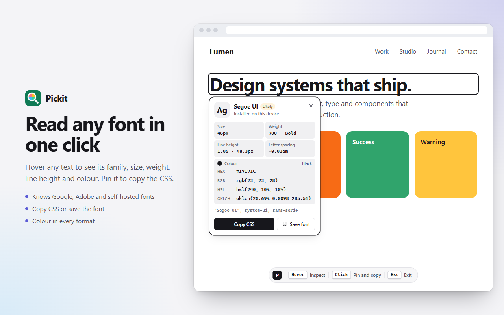
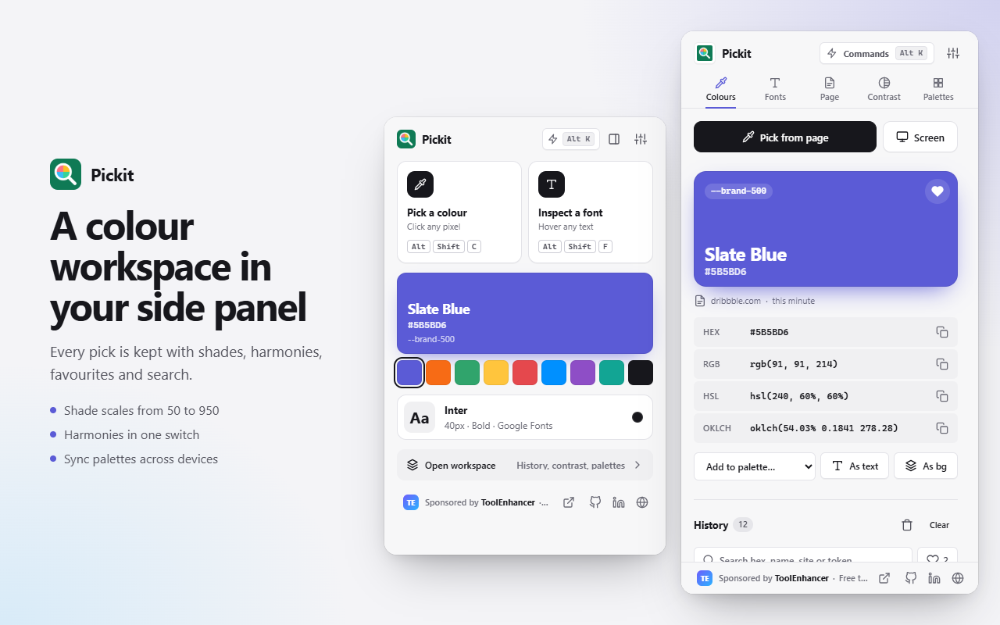
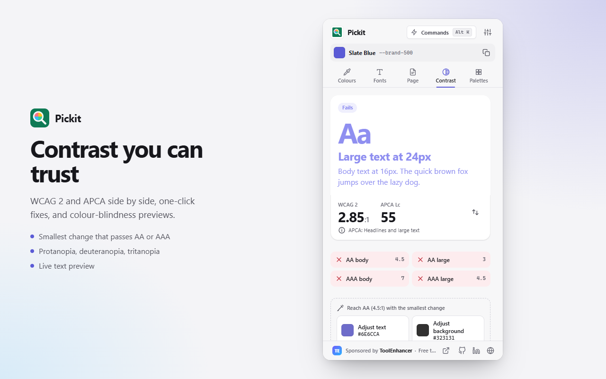
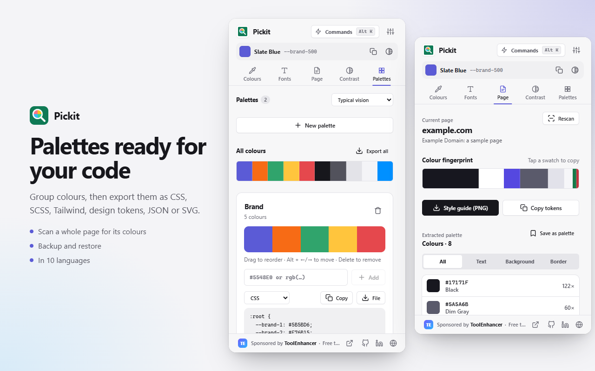

<div align="center">


# Pickit

**Color picker & font detector for Chrome.**
Pick any colour, detect any font, check contrast and export palettes, without leaving the page.

[](https://github.com/Toolvanta/Pickit)
[](https://www.linkedin.com/in/shoaibmarif/)
[](https://shoaibarif.vercel.app/)


[](LICENSE)



</div>

## Sponsor

Pickit is sponsored by **[ToolEnhancer](https://toolenhancer.com/)**: free online tools for images,
video, audio and PDFs that run right in your browser.

## Features

| | |
|---|---|
| **Colour picker** | Pixel-perfect loupe, Shift+click to pick several, pick from anywhere on screen. Copy as HEX, RGB, HSL or OKLCH. Finds the CSS variable behind a colour. |
| **Font detector** | Hover any text for family, size, weight, line height, letter spacing and colour. Knows Google, Adobe and self-hosted fonts. Copy the CSS in one click. |
| **Side panel workspace** | History with favourites and search, shade scales (50 to 950), harmonies, page scan with a downloadable style guide. |
| **Contrast checker** | WCAG 2 and APCA side by side, one-click fixes to reach AA or AAA, colour-blindness previews. |
| **Palettes** | Export as CSS, SCSS, Tailwind, design tokens (W3C), JSON or SVG. Optional Chrome sync, backup and restore. |
| **Private** | Reads a page only when you invoke it. No account, no analytics, no server. |
| **Global** | English, Deutsch, Español, Français, Português, Русский, العربية (right-to-left), 日本語, 简体中文, हिन्दी. |

## Screenshots

| | |
|---|---|
|  |  |
|  |  |
|  | |

## Install

**From the Chrome Web Store:** coming soon.

**From source:**

```bash
git clone https://github.com/Toolvanta/Pickit.git
cd Pickit
npm install
npm run build
```

Then open `chrome://extensions`, turn on **Developer mode**, click **Load unpacked** and choose
the `.output/chrome-mv3` folder. Pin Pickit from the puzzle icon in the toolbar.

| Shortcut | Action |
|---|---|
| `Alt+Shift+C` | Pick a colour |
| `Alt+Shift+F` | Inspect a font |
| `Alt+K` | Command menu (in the popup and side panel) |

Change shortcuts at `chrome://extensions/shortcuts`.

## Development

Requirements: Node.js 20 or newer and Google Chrome.

| Command | What it does |
|---|---|
| `npm run dev` | Development build with hot reload, in a separate Chrome window |
| `npm run build` | Production build into `.output/chrome-mv3` |
| `npm run zip` | Production build zipped for the Chrome Web Store |
| `npm test` | Unit and integration tests (Vitest) |
| `npm run typecheck` | TypeScript check |
| `npm run preview` | Builds, then serves every page with stand-in `chrome.*` APIs at `http://localhost:4517/harness.html` |
| `npm run store` | Builds, then renders the store screenshots and promo tiles into `store/` with headless Chrome |
| `npm run icons` | Regenerates the PNG icons from `assets/icon.svg` |

**Preview without loading the extension.** `npm run preview` serves the popup, side panel,
settings and welcome pages with fake `chrome.*` APIs and sample data, plus a test page where the
real picker and font inspector run. Add `?lang=de` (or `ar`, `ja`, …) to any page URL to see a
translation; `ar` shows the right-to-left layout.

Before opening a pull request, run `npm run typecheck` and `npm test`. Both must pass.

## Project structure

```
src/
  core/                 Logic with no UI framework (unit-tested)
    color.ts            Colour parsing, formats, WCAG/APCA contrast, OKLCH, vision simulation
    fonts.ts            Font detection and font CSS
    scan.ts             Whole-page colour and font scan
    storage.ts          Typed chrome.storage wrapper and history rules
    sync.ts             Palette/favourite sync rules (pure)
    sync-engine.ts      Wires sync to storage events in the background worker
    backup.ts           Backup file format and validation
    export.ts           Palette export (CSS, SCSS, Tailwind, tokens, JSON, SVG)
    i18n.ts             Translation helper (t, tp) and right-to-left support
    config.ts           Product constants: shortcuts, sponsor, maker links
    overlay/            In-page picker: shadow-DOM shell, colour loupe, font card
  entrypoints/          One folder per extension page
    background.ts       Service worker: injects the overlay, captures, relays, sync
    overlay.ts          Injected into a tab only when a picker or scan starts
    popup/ sidepanel/ options/ welcome/
  ui/                   Design tokens, shared React components and icons
public/_locales/        All interface text in 10 languages
scripts/preview/        Preview harness and chrome.* stand-in
scripts/store/          Store artwork scenes, demo page and capture script
store/                  Generated store images and the listing text (store/listing.md)
tests/                  Vitest suites
```

## How to add things

### Interface text (any visible string)

All text lives in `public/_locales/<lang>/messages.json`. Never hard-code English in a component.

1. Add the key to `public/_locales/en/messages.json` with a `description` for translators:
   ```json
   "colors_my_label": { "message": "Copied {0}", "description": "Toast after copying; {0} is the value" }
   ```
2. Use it: `import { t } from '@/core/i18n'`, then `t('colors_my_label', value)`.
   For counts use `tp('key', n)` and add `key_one` and `key_other` (other languages add their own plural forms, such as Russian `_few` and `_many`).
3. Add the key to the other 9 language files.

`npm test` fails if a key is missing in any language or a `{0}` placeholder is dropped.

### A new language

1. Create `public/_locales/<code>/messages.json` (Chrome locale codes, such as `it` or `ko`) with every key from the English file.
2. Run `npm test`. The i18n test checks every locale folder for completeness and placeholders.
3. Preview it with `npm run preview` and `?lang=<code>`.

### A colour format

1. `src/core/color.ts`: add it to `ColorFormat` and `COLOR_FORMATS`, and handle it in `formatColor()` (and `parseColor()` if it should be accepted as input).
2. Add a label to `FORMAT_LABELS` in `src/ui/components.tsx` and `src/core/overlay/font-inspector.ts`.
3. Add tests in `tests/color.test.ts`. The Settings page lists formats automatically.

### An export format

1. `src/core/export.ts`: add it to `ExportFormat` and `EXPORT_FORMATS`, its file extension in `exportExtension()`, and its output in `exportColors()`.
2. Add tests in `tests/export.test.ts`. The Palettes tab picks it up automatically.

### A setting

1. `src/core/storage.ts`: add the field to `Settings` and a default to `DEFAULTS.settings`.
2. `src/core/backup.ts`: read and validate it in `parseBackup()` so backups carry it.
3. `src/entrypoints/options/App.tsx`: add a `<Setting>` row, with its text in the locale files.
4. Read it with `useStored('settings')` in pages, or `getState('settings')` in the overlay and worker.

### A side panel tab

1. Create `src/entrypoints/sidepanel/MyTab.tsx`.
2. Register it in `TABS` and the tab switch in `src/entrypoints/sidepanel/App.tsx`, and add a command to the command menu there.
3. Update the five-column grid in `.tabs` (`src/entrypoints/sidepanel/style.css`) if you add a sixth tab.

### Store screenshots

Edit the copy or layout in `scripts/store/scenes.html`, then run `npm run store`. The script
uses your installed Chrome (set `CHROME_PATH` if it is somewhere else).

### Sponsor or maker links

Change `SPONSOR` and `CREATOR` in `src/core/config.ts`. They appear only on Pickit's own
pages, never on websites, as Chrome Web Store policy requires.

## Design principles

- **Invoke, don't watch.** Nothing runs on a page until the user starts a picker there.
- **Stay out of the page.** The overlay lives in a closed shadow root and works under strict CSP.
- **The picked colour is the accent.** The UI is neutral; the colour you inspect tints it.
- **Every string translatable, every control reachable by keyboard.**

## Privacy

Pickit stores everything in your browser and sends nothing anywhere. See [PRIVACY.md](PRIVACY.md).

## Publishing

The full store listing (title, descriptions, permission justifications and privacy answers)
and all images are in [`store/`](store/listing.md). Bump `version` in `package.json`, run
`npm run zip` and upload `.output/pickit-<version>-chrome.zip`.

## Contributing

Issues and pull requests are welcome. See [CONTRIBUTING.md](CONTRIBUTING.md).

## License

[MIT](LICENSE) © Shoaib Arif

## Author

Made by **Shoaib Arif**:
[Portfolio](https://shoaibarif.vercel.app/) ·
[LinkedIn](https://www.linkedin.com/in/shoaibmarif/) ·
[GitHub](https://github.com/Toolvanta/Pickit)

Sponsored by [ToolEnhancer](https://toolenhancer.com/).
